# Night Sail — design review

Three self-hosted SVG treatments built from the same carefully aligned sailboat, ivory sails, compact Myanmar flag, and fixed text. These are **original vector compositions**, not generated frame sequences. They retain the same 1200 × 360 viewBox, with a 16-second seamless ocean/boat cycle and independent 4-second gentle flag motion.

The current README continues to use **Balanced Natural** (`assets/ocean-sail.svg`) as the default. **Nothing in this review is merged into `main` until you approve the pull request.**

## 1 — Premium Minimal

- Fewer decorative wave accents, less sky glow, subdued sea colors.
- Delicate hull reflection and low-motion ocean; meteor intentionally hidden.
- Best for understated, high-end editorial presentation.

[View SVG](./assets/ocean-sail-premium.svg)

## 2 — Balanced Natural (recommended default)

- Layered rolling swells, restrained selective whitecaps, gentle wake.
- A small Myanmar flag attached directly to the mast, softly fluttering to the left.
- One brief meteor, then a calm night-sky loop.
- Best balance of personal identity, motion and readability.

[View SVG](./assets/ocean-sail.svg)

## 3 — Cinematic Night Sail

- Deeper atmospheric sky haze and warmer boat/water reflections.
- More pronounced but still restrained light accents, without additional wave-line clutter.
- Best for a richer, more immersive mood.

[View SVG](./assets/ocean-sail-cinematic.svg)

## Static fallback

[View static SVG](./assets/ocean-sail-still.svg)

## Review checklist

- [ ] Inspect the three alternatives in GitHub **Files changed / Preview** or open the raw SVG images.
- [ ] Confirm the compact Myanmar flag direction, proportion, colors, and attachment to mast.
- [ ] Confirm text contrast and legibility at desktop and narrow/mobile widths.
- [ ] Verify that the 16-second animation looks smooth in your browser and GitHub interface; browsers can differ in SVG SMIL behavior.
- [ ] Choose Premium / Balanced / Cinematic; if desired, switch just the filename in `README.md` after review.

## Implementation notes

- All artwork is repository-local, with no external fonts, image APIs, or animation services.
- All name and role text is stationary. Only sea, reflections, boat, flag and meteor have motion.
- The original README content, genuine team/project links, and existing source image attribution are preserved.
- The static fallback is available if GitHub or a particular device suppresses motion.
- **No actual 3D/WebGL scene is embedded.** The banner uses layered SVG vector shading to suggest depth while remaining GitHub-friendly.
