  

  Computer Science at <strong>University of Illinois Chicago</strong> &nbsp;·&nbsp; Electrical Engineering minor &nbsp;·&nbsp; Chicago
   
  Open to <strong>Summer 2027 software engineering internships</strong>

  <a href="#selected-work">Selected work</a> &nbsp;·&nbsp;
  <a href="https://www.linkedin.com/in/thantsynhtet/">LinkedIn</a> &nbsp;·&nbsp;
  <a href="mailto:thtet@uic.edu">Email</a>

---

### About

I'm a software engineering student interested in building reliable systems that turn complex data into practical tools. I gravitate toward **backend and platform engineering, ML infrastructure, and distributed systems**—and enjoy working across application development, scientific computing, and hardware.

At UIC, I study Computer Science with a Software Engineering concentration and an Electrical Engineering minor. I expect to graduate in **December 2027**. Beyond engineering, I founded UIC's Burmese Student Association, have served in ACM leadership, and previously competed as a national sailing athlete for Myanmar.

### Selected work

The five projects below match my selected GitHub portfolio projects. Team-owned repositories remain linked to their original maintainers.

<table>
<tr>
<td colspan="2" valign="top">

**[Conquering Mars — NASA Space Apps 2026](https://github.com/isa9955/NASA-Space-Apps-2026)**

A team-built Mars terrain and exploration planner. The application visualizes HiRISE-derived terrain, compares standard and uncertainty-aware routes, and makes assumptions and gaps in the evidence explicit.

Python · React · TypeScript · Three.js · Microsoft Azure

Image: actual application screenshot from the <a href="https://github.com/isa9955/NASA-Space-Apps-2026/blob/main/docs/images/habitat-finder.jpg">project repository</a>, not an AI-generated illustration.

</td>
</tr>
<tr>
<td width="50%" valign="top">

**[WhaleSong Analysis](https://github.com/JohnThantSynHtet/WhaleSong-Analysis)**

Full-stack whale audio analysis with ML-assisted species detection, spectrograms, and recording workflows. Developed collaboratively as a software engineering project.

Java · Spring Boot · Python · FastAPI · ML

</td>
<td width="50%" valign="top">

**[Weather App](https://github.com/JohnThantSynHtet/Weather_App)**

Team-built JavaFX weather application integrating National Weather Service forecasts, city search, hourly and weekly views, and reusable UI components.

Java · JavaFX · REST APIs · Testing

</td>
</tr>
<tr>
<td width="50%" valign="top">

**[PathReview](https://github.com/ascherj/pathreview)**

AI-powered portfolio review assistant developed in a collaborative project setting, with repository and résumé analysis, retrieval-augmented feedback, and a web dashboard.

Python · FastAPI · RAG · React

</td>
<td width="50%" valign="top">

**[PairPod](https://github.com/Kirikmelet/pairpod)**

A web application and Chrome extension for page-based communities, messaging, and profiles, with a 3D peer-room experience.

Next.js · TypeScript · Supabase · Chrome Extension · Three.js

</td>
</tr>
</table>

### Engineering toolkit

**Languages** &nbsp; Python · Java · Go · C/C++ · JavaScript / TypeScript · SQL

**Backend & data** &nbsp; Spring Boot · FastAPI · REST APIs · PostgreSQL

**Infrastructure & ML** &nbsp; Docker · AWS · GitHub Actions · PyTorch

---

  <a href="https://www.linkedin.com/in/thantsynhtet/">LinkedIn</a> &nbsp;·&nbsp;
  <a href="mailto:thtet@uic.edu">thtet@uic.edu</a>

